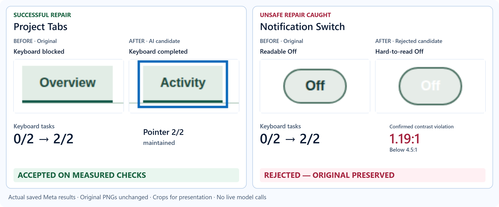
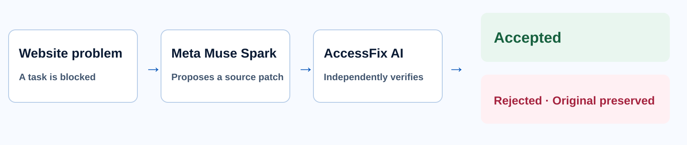

<h1></h1>

**Don't just fix accessibility issues. Prove users can complete their tasks.**

Meta Muse Spark proposes accessibility fixes; AccessFix AI independently tests real browser tasks and rejects unsafe changes.

<picture>
  <source media="(max-width: 600px)" srcset="assets/graphical-abstract-mobile.png" />
  
</picture>

*Actual saved Meta results. Crops and labels are for presentation; original PNGs are unchanged. The Switch After is a rejected AI candidate.*

<picture>
  <source media="(max-width: 600px)" srcset="assets/process-flow-mobile.svg" />
  
</picture>

| Measured outcome | Project Tabs | Notification Switch |
|---|---|---|
| Keyboard tasks | **0/2 → 2/2** | **0/2 → 2/2** |
| Pointer tasks | **2/2 maintained** | **2/2 maintained** |
| New confirmed regression | None observed in measured states | **Text contrast 1.19:1**, below applicable 4.5:1 |
| Decision | **Accepted on measured criteria** | **Rejected — original preserved** |

**Recorded results from actual Meta API requests — No live model calls.** These are bounded experiments, not full WCAG certification or arbitrary-website repair.

## Watch Demo / Try Read-Only Demo

| Destination | Publication status | Local review |
|---|---|---|
| Watch Demo | `VIDEO_URL_PENDING` | [English narration](media/accessfix-joanna-final-narrated.mp4) · [Captions only](media/accessfix-joanna-final-captioned.mp4) · [SRT](media/accessfix-joanna-final.en.srt) |
| Try Read-Only Demo | `READ_ONLY_DEMO_URL_PENDING` | Run the included static RC4 demo below |
| GitHub repository | `GITHUB_URL_PENDING` | This is a review candidate; no repository URL has been invented |

The video shows actual RC4 browsing of preserved experiments. It does not show a live model repair. Public links await owner publication.

## Run the working code

For the static recorded demo, no model credentials or Docker are needed:

```powershell
python public-demo/scripts/serve.py --port 8833
```

For the Python/FastAPI repair engine and its original product UI (Python 3.12, Node.js 22+, pnpm):

```powershell
python -m venv .venv
.venv\Scripts\python.exe -m pip install -r requirements.txt
pnpm --dir frontend install --frozen-lockfile --ignore-scripts
pnpm --dir frontend run build
.venv\Scripts\python.exe scripts/install_demo_evidence.py evidence/accessfix-demo-evidence.zip --destination . --sha256 05cff33e4fc04912c360111456e5789573f5f2762c4e6e639f883331448b2011
.venv\Scripts\python.exe release/run_demo.py --port 8808
```

Open `http://127.0.0.1:8808/`. This default launch disables new model repairs. Replaying evidence does not incur model charges. Docker browser verification and opt-in model configuration are documented in [the technical guide](docs/TECHNICAL_GUIDE_RC4.md) and [preserved engine instructions](provenance/BLUE_ORIGINAL_README.md). Do not expose the development engine as the public demo.

## How It Works

1. **Experience the problem.** Measure whether keyboard and pointer users complete the original task. A key event alone is not success.
2. **See the AI repair.** Meta Muse Spark generates a bounded source patch. The proposal is separate from its verification.
3. **See the difference.** An independent Playwright run checks task outcomes, existing pointer behavior and axe-core findings. Required missing measurements block acceptance.
4. **Read the verdict.** Accept only the measured improvement under the fixed contract. Reject unsafe candidates and retain the original and the failed patch as evidence.

In Tabs, the saved candidate reaches Activity and the note workflows pass. In Switch, replacing a clickable element with a native button fixes keyboard activation but changes inherited text styling. The candidate contains no CSS edit; the browser still finds the new contrast violation.

## Architecture

The **repair engine** and the **public demonstration** have different responsibilities:

| Layer | What it does | Source |
|---|---|---|
| Registered-app orchestration | Loads a reviewed task and coordinates a bounded repair | [service.py](backend/accessfix/service.py) |
| Model adapter | Calls the configured repair provider; historical Meta ID is preserved | [providers.py](backend/accessfix/providers.py) |
| Patch boundary | Applies only permitted edits and keeps source recoverable | [patching.py](backend/accessfix/patching.py) |
| Independent browser verification | Runs keyboard/pointer tasks and observed-state audits in the isolated runtime | [runtime](runtime/README.md) |
| Acceptance gate | Uses browser evidence rather than the model's success claim | [gate.py](backend/accessfix/gate.py) |
| Public RC4 site | Static React UI reads reviewed JSON, patches and PNGs; no model or write endpoint | [public-demo](public-demo/README.md) |

The engine's browser containers are network-isolated, resource-limited and restricted to reviewed apps. Model credentials are not mounted into the browser runtime. Chromium's internal sandbox remains disabled in that environment, so arbitrary hostile repositories are not supported. The static public site does not run that engine.

## Experimental Results

The six displayed cases retain their original decisions. Counts are observed state–rule–node findings, not percentages of whole-site accessibility.

| Experiment | Keyboard before → candidate | Pointer maintained | axe violations before → candidate | axe incomplete before → candidate | Decision |
|---|---|---|---|---|---|
| Project Tabs · M4 | 0/2 → 2/2 | 2/2 | 0 → 0 | 0 → 0 | Accepted |
| Notification Switch · M4 | 0/2 → 2/2 | 2/2 | 0 → 1 | 4 → 4 | Rejected: new contrast violation |
| Delivery preferences · M3 | 0/3 → 3/3 | 2/2 | 1 → 0 | 0 → 0 | Accepted |
| Order action · M4 | 0/2 → 2/2 | 2/2 | 12 → 0 | 0 → 0 | Accepted |
| Workspace menu · M4 | 0/2 → 2/2 | 2/2 | 15 → 15 | 2 → 2 | Accepted, review remains |
| Public Tic Tac Toe · M5 | 0/2 → 2/2 | 3/3 | 0 → 0 | 0 → 16 | Rejected: new incomplete signatures |

M4 used four one-shot `muse-spark-1.3-contributor` requests, **32,062 tokens**, with no automatic retry. Three accepted candidates out of four is not a complete accessibility resolution rate. M3 and M5 are separate experiments; OpenAI M1 results remain separately labeled in the preserved technical material.

Menu retains confirmed findings and manual review. Some stored Menu checks have a serialized expected/observed discrepancy, which the viewer reports without changing the original verdict. M5's **16 new incomplete signatures are not 16 confirmed violations**. Separate screenshot review found lost board outlines that the task verifier missed.

<details>
<summary>Historical model requests, tokens and response times</summary>

| Case | Actual requests | Tokens | Response seconds |
|---|---:|---:|---:|
| Project tabs | 1 | 8,375 | 51.187 |
| Notification switch | 1 | 5,133 | 20.969 |
| Delivery preferences | 1 | 8,553 | 42.531 |
| Order action | 1 | 6,224 | 21.281 |
| Workspace menu | 1 | 12,330 | 59.109 |
| Public Tic Tac Toe | 1 | 7,646 | 44.843 |

All six rows requested and returned `muse-spark-1.3-contributor`. These are historical calls, not calls made to create this README, video or RC4 site. Monetary cost was not recorded and is unknown, not zero.

</details>

## Reproduction / Technical Evidence

Run the bundled read-only RC4 site with Python 3.12; its completed build is included and no model key is needed:

```powershell
python public-demo/scripts/serve.py --port 8833
```

Open `http://127.0.0.1:8833/`. If that port is already serving the approved RC4, keep using it. To rebuild only the static UI, use the pinned package and lockfile in `public-demo/`; the documented engine installation and Docker procedures are preserved in [the technical guide](docs/TECHNICAL_GUIDE_RC4.md).

| Claim | Original reviewed evidence |
|---|---|
| Tabs patch and outcomes | [Patch](public-demo/public/evidence/tabs/patch.diff) · [Before tasks](public-demo/public/evidence/tabs/before-tasks.json) · [After tasks](public-demo/public/evidence/tabs/after-tasks.json) · [Decision](public-demo/public/evidence/tabs/decision.json) |
| Switch regression and rejection | [Patch](public-demo/public/evidence/switch/patch.diff) · [Contrast audit](public-demo/public/evidence/switch/contrast-audit.json) · [Decision](public-demo/public/evidence/switch/decision.json) |
| Model identity and usage | [Tabs metadata](public-demo/public/evidence/tabs/model.json) · [Switch metadata](public-demo/public/evidence/switch/model.json) |
| All 69 public files | [Evidence provenance manifest](provenance/RC4_EVIDENCE_MANIFEST.json) |
| RC4 interface validation | [UI QA report](docs/RC4_UI_QA_KO.md) · [Read-only security check](provenance/RC4_SECURITY.json) |

Each public file has a SHA-256 and preserved/derived status. Reviewed copies retain source references. Raw authenticated traces, model request/response logs, private paths and development Git history are excluded. Missing evidence is not a pass. A fresh build is not retroactive reproduction of a frozen historical environment.

## Limitations / Provenance / License

- Accepted means the fixed experiment's measured criteria passed, **not full WCAG conformance**. Blocked original workflows leave later states unmeasured.
- axe incomplete findings require review. RC4's own UI has **18 remaining expanded-code incomplete occurrences**, separate from the historical repair results.
- Screen-reader behavior and first-time judge comprehension time were not measured. Visual review can find regressions that task assertions miss.
- The public demo explores stored records. It does not instantly repair arbitrary internet websites, execute uploaded repositories or make live model calls.
- AccessFix AI's official implementation was developed as an independent codebase. Earlier research PoC code was not copied into this build; earlier development timestamps remain unchanged.
- The M5 Tic Tac Toe module is external MIT code from Sadanand Pai's `frontend-mini-challenges`, pinned at the commit below. [Its provenance and adaptation](evaluation/m5_public_tictactoe/README.md) and original license are retained. It is not claimed as newly authored AccessFix code.
- Newly authored AccessFix AI code is licensed under the [MIT License](LICENSE), adopted with owner approval on November 4, 2026. The archived MIT proposal is retained as historical documentation. Existing fixture, upstream and dependency licenses remain in force for their respective files. See [third-party notices](release/THIRD_PARTY_NOTICES.md).

The presentation uses original saved screenshots with labeled crops. New RC4 footage shows navigation of those records; no new repair inference was performed. The final 165-second video uses Amazon Polly Joanna Neural narration, approved by the project owner after listening. [Voice rights](docs/JOANNA_VOICE_RIGHTS_KO.md). Codex assisted development and preparation; it is separate from the Meta repair model.

External publication and official submission remain subject to owner approval. This candidate has not been pushed, hosted, uploaded to YouTube or submitted.

Pinned M5 upstream commit (full identifier):

```text
48b7dae8bae41e4c69b904c7793bb8a4f892f337
```
